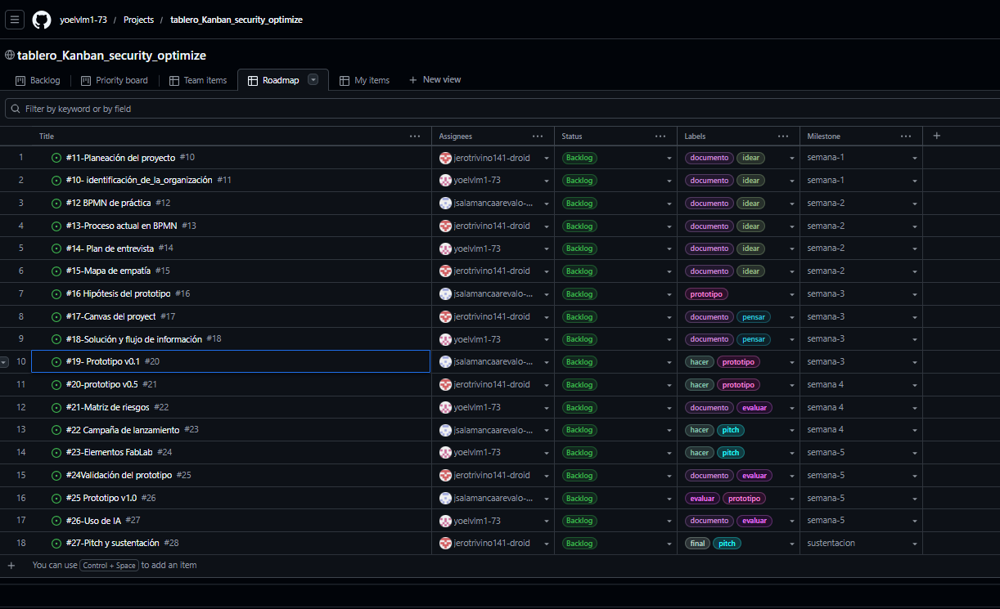
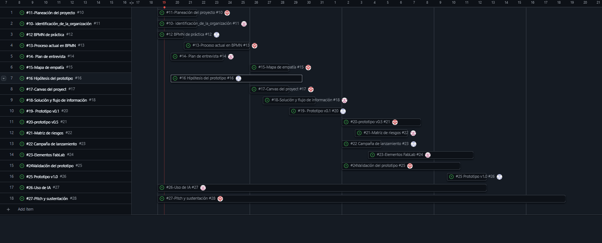

Planeación proyecto  
Roles  
LP – Lider proyecto: yoelvlm1-73   
AP – Analista de procesos: jsalamancaarevalo-debug  
UX – Usuario y campaña: jerotrivino141-droid 
PR – Prototipo: yoelvlm1-73  
 
Issues a cargo:  
ROL         | Issues                       | Justificación |                   
Lider       | #11, #17, #24, #27           | Organiza el plan, define el canvas, valida el prototipo y lidera el pitch y la sustentación           |  
AP          | #10, #14, #18, #21, #23, #26 | Identifica la organización, planea la entrevista, diseña el flujo, evalúa riesgos, FabLab y uso de IA |    
UX          | #12, #15, #22                | Trabaja el BPMN de práctica, el mapa de empatía y la campaña de lanzamiento                           |   
PR          | #13, #16, #19, #20, #25      | Modela el proceso actual, plantea la hipótesis y construye el prototipo v0.1, v0.5 y v1.0             |   
  
Hitos   
Semana # | Fecha limite | Resultado |  
Semana 1 | 21/10/2026 | Organización identificada y tablero con Gantt |  
Semana 2 | 25/10/2026 | BPMN del proceso actual, entrevista y mapa de empatía |  
Semana 3 | 01/11/2026 | Canvas, solución y prototipo v0.1 |  
Semana 4 | 08/11/2026 | Prototipo v0.5, riesgos y campaña |  
Semana 5 | 12/11/2026 | Validación, FabLab, prototipo v1.0 y pre-sustentación |  
Semana 6 | 13/11/2026 | Exposición ante jurados | 
  
Tablero y cronograma  
  
  
