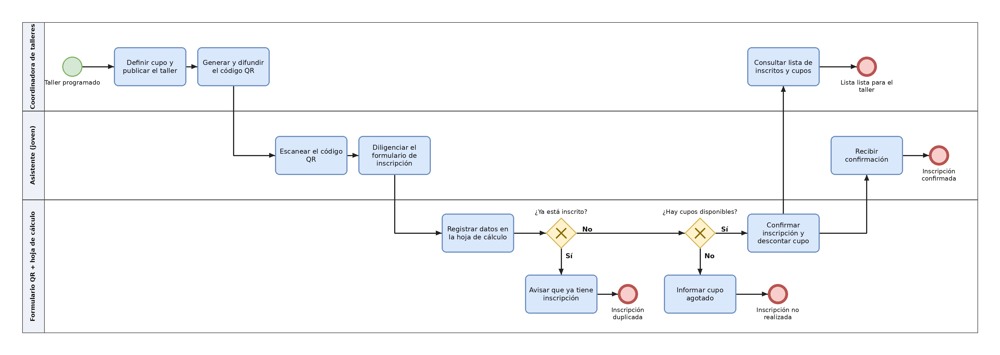

# Proceso actual

## 1. BPMN de práctica 

 

Declaración de IA: 
Claude Sonnet 5.5 (Anthropic) – 23/10/2026 – prompt registrado en docs/11-uso-ia.md 

## 2. El proceso elegido 

Nombre del proceso: Fabricación, transporte e instalación de puertas de seguridad 

Carriles (responsables): Cliente; Gerencia y ventas; Producción; Transporte e instalación 

Fuente (contacto, cargo y fecha): Orlando Morales, gerente general de Multy Security (lo conoce Yoel Morales) – [23/10/2026] 

## 3. Pasos del proceso  

| # | Paso (verbo + objeto) | Responsable | 
|---|---|---|
| 1 | Contactar a Multy Security | Cliente | 
| 2 | Atender al cliente y cotizar | Gerencia y ventas | 
| 3 | Generar la orden de producción | Gerencia y ventas | 
| 4 | Solicitar piezas metálicas al proveedor | Producción | 
| 5 | Recibir e inspeccionar las piezas | Producción | 
| 6 | Devolver al proveedor y pedir corrección | Producción | 
| 7 | Fabricar la puerta (corte, soldadura y acabado) | Producción | 
| 8 | Transportar la puerta al sitio del cliente | Transporte e instalación | 
| 9 | Instalar la puerta | Transporte e instalación | 
| 10 | Corregir la instalación | Transporte e instalación | 
| 11 | Entregar y firmar acta de entrega | Transporte e instalación | 
| 12 | Recibir y aprobar la entrega | Cliente | 

Decisión: ¿Cliente acepta la cotización? Sí: Generar la orden de producción (paso 3). No: Venta no concretada (fin del proceso). 

Decisión: ¿Piezas conformes? Sí: Fabricar la puerta (paso 7). No: Devolver al proveedor y pedir corrección (paso 6), y se vuelve a Solicitar piezas metálicas al proveedor (paso 4). 

Decisión: ¿Instalación conforme? Sí: Entregar y firmar acta de entrega (paso 11). No: Corregir la instalación (paso 10), y se vuelve a Instalar la puerta (paso 9). 

## 4. Diagrama BPMN 

 

## 5. Puntos críticos 

| PC | Qué pasa (se demora, se repite o se pierde) | Evidencia (dato o frase del contacto, con fecha) | 
|---|---|---|
| PC1 | Se repite: cuando las piezas del proveedor no son conformes, se devuelven y se vuelven a solicitar (pasos 4 a 6) | [evidencia – dd/mm/aaaa] |  
| PC2 | Se repite: cuando la instalación no es conforme, se corrige y se instala de nuevo (pasos 9 y 10) | [evidencia – dd/mm/aaaa] | 

## 6. Uso de IA 

| Herramienta y versión | Fecha | Prompt | 
|---|---|---|
| Claude Sonnet 5.5 | 23/10/2026 | Dame el md de la planeación del proyecto según la guía (Paso 5, 03.proceso_actual.md), usando solo el BPMN de Multy Security como proceso actual | 
