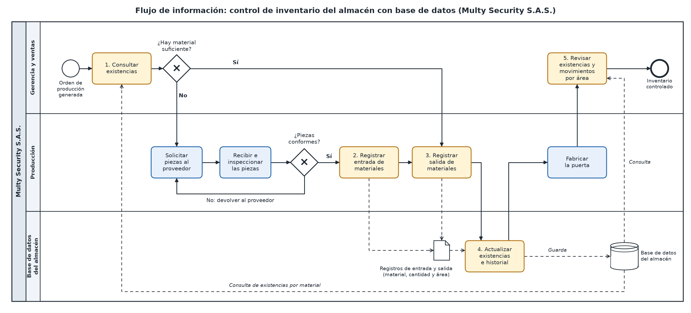

06 · Solución y flujo de información  
 
  
 
Solución propuesta  
 
Qué cambia en el proceso con la solución (máximo 5 líneas): El conteo manual y físico en papel y Excel deja de ser la única fuente de información del inventario. Multy Security S.A.S. tendrá una base de datos del almacén donde se registran las entradas y salidas de materiales por área de trabajo. Cada movimiento actualiza las existencias y queda guardado en un historial. Antes de iniciar la producción, Orlando Morales consulta qué material hay y, si falta, se solicita al proveedor. Así se reducen los retrasos en los pedidos y el riesgo de comprar un material dos veces o perderlo.

Flujo de información
Flujo de información

Paso	Entrada (qué información llega)	Proceso (qué se hace)	Responsable (quién)	Salida (qué información sale)
1	Orden de producción con los materiales requeridos	Consultar en la base de datos si hay existencias suficientes	Gerencia y ventas (Orlando Morales)	Existencias por material y decisión: hay material suficiente o se debe solicitar al proveedor
2	Piezas metálicas recibidas e inspeccionadas como conformes (material y cantidad)	Registrar la entrada en el formulario de entradas	Producción	Registro de entrada (material, cantidad y área de trabajo)
3	Orden de producción y material disponible para fabricar	Registrar la salida en el formulario de salidas	Producción	Registro de salida (material, cantidad y área de trabajo)
4	Registros de entrada y de salida	Actualizar las existencias y guardar los movimientos en el historial	Base de datos del almacén (sistema)	Existencias actualizadas e historial de movimientos
5	Existencias actualizadas e historial de movimientos	Revisar las existencias y los movimientos por área de trabajo	Gerencia y ventas (Orlando Morales)	Información del inventario para controlar el material y planear los pedidos
Antes y después
Proceso actual	Proceso con la solución
El inventario se hace con conteo manual y físico, primero en papel y luego en Excel	Las entradas y salidas se registran en formularios de una base de datos del almacén
La visibilidad del inventario llega tarde	Las existencias se pueden consultar cuando se necesitan, sin depender solo del conteo físico
Se puede perder información y hay diferencias entre el inventario manual y el físico	Cada movimiento queda guardado en un historial que se puede consultar
No siempre se sabe cuánto material hay, lo que retrasa los pedidos (ocurrió hace 2 semanas)	Se verifica el material antes de producir y, si falta, se solicita al proveedor
Existe riesgo de comprar un material dos veces o de perderlo	Se identifica qué material entró y salió, en qué cantidad y para qué área de trabajo
