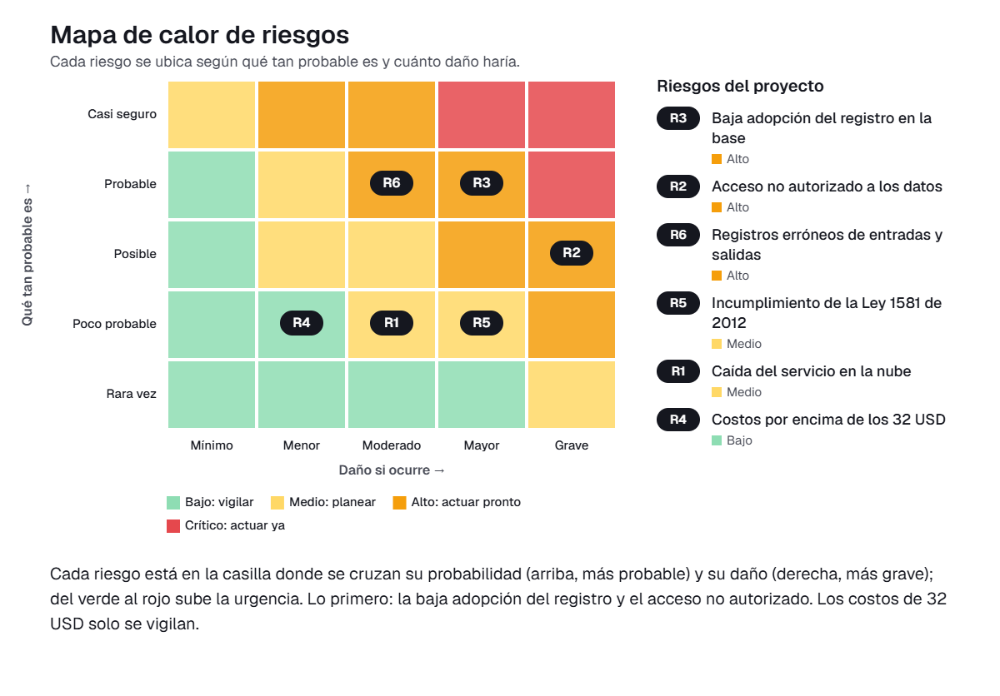

# Matriz de gestión de riesgos

En este documento identificamos y valoramos los riesgos de implementar en Multy Security S.A.S. la base de datos del almacén, que Orlando Morales y los funcionarios y colaboradores de la organización usarán a diario para registrar entradas y salidas de materiales por área de trabajo. La solución se apoya en un servicio en la nube y un dominio propio, con un presupuesto total de 32 dólares (20 dólares de nube y 12 dólares de dominio). Esto condiciona las medidas que proponemos.

Calculamos el nivel de cada riesgo como probabilidad (1-5) × impacto (1-5). Lo clasificamos así: 1-4 bajo, 5-9 medio, 10-16 alto y 20-25 crítico.

## Matriz de riesgos

| ID | Riesgo | Categoría | P | I | Nivel | Tratamiento | Acción | Responsable | Fecha |
|----|--------|-----------|---|---|-------|-------------|--------|-------------|-------|
| R1 | Caída del servicio en la nube | Tecnológico | 2 | 3 | 6 (Medio) | Mitigar | Exportar cada semana una copia de la base de datos y definir el procedimiento para seguir registrando los movimientos en una hoja temporal mientras el servicio se restablece. | PR | 14 nov |
| R2 | Acceso no autorizado a los datos | Datos y ciberseguridad | 3 | 5 | 15 (Alto) | Mitigar | Crear usuarios individuales con roles (consulta y registro), usar contraseñas seguras y activar la verificación en dos pasos en la cuenta de la nube y del dominio. | PR | 7 nov |
| R3 | Baja adopción del registro en la base | Personas y adopción | 4 | 4 | 16 (Alto) | Mitigar | Hacer una capacitación corta con los funcionarios y colaboradores, entregar una guía de una página para los formularios y acordar con Orlando Morales que, durante la prueba, todo movimiento se registre primero en la base. | UX | 10 nov |
| R4 | Costos por encima de los 32 USD | Financiero | 2 | 2 | 4 (Bajo) | Aceptar | Mantener el plan básico de nube y el dominio contratado. Revisar el gasto al cierre de la prueba y no contratar servicios adicionales durante el proyecto. | LP | 5 nov |
| R5 | Incumplimiento de la Ley 1581 de 2012 | Legal | 2 | 4 | 8 (Medio) | Mitigar | Limitar los datos personales a nombre y usuario de quienes registran, informar su finalidad, obtener la autorización de cada persona y establecer una política interna de tratamiento de datos. | AP | 13 nov |
| R6 | Registros erróneos de entradas y salidas | Operativo | 4 | 3 | 12 (Alto) | Mitigar | Definir campos obligatorios (material, cantidad y área de trabajo) y hacer un conteo físico semanal de contraste para corregir diferencias. | UX | 12 nov |

## Riesgos altos y críticos

No identificamos riesgos críticos. Tres riesgos quedaron en nivel alto y los tratamos primero.

### R3 – Baja adopción del registro en la base (nivel 16)

Es el riesgo más grave porque la base de datos solo sirve si cada entrada y salida queda registrada. Si los colaboradores siguen con el conteo manual en papel y Excel, las existencias dejan de coincidir con el almacén y volvemos al problema original.

- **Plan:** capacitamos al personal, entregamos la guía de uso y acordamos con Orlando Morales que todo movimiento se registre primero en la base durante la semana de prueba.
- **Seguimiento:** revisamos a diario si el número de movimientos registrados corresponde a la actividad del almacén.
- **Responsable y fecha:** UX, 10 nov.

### R2 – Acceso no autorizado a los datos (nivel 15)

La base concentra la información del inventario de la organización y está en la nube. Una persona sin permiso podría consultarla, modificarla o borrarla.

- **Plan:** usuarios individuales con roles, contraseñas seguras y verificación en dos pasos en las cuentas de la nube y del dominio. Solo Orlando Morales administra los permisos.
- **Seguimiento:** revisamos la lista de usuarios activos antes de iniciar la prueba y al terminarla.
- **Responsable y fecha:** PR, 7 nov.

### R6 – Registros erróneos de entradas y salidas (nivel 12)

Un material o una cantidad mal digitados generan existencias que no coinciden con el almacén. Eso puede llevar a decidir mal si se compra al proveedor o se produce.

- **Plan:** campos obligatorios en los formularios de entradas y salidas y un conteo físico semanal de contraste. Con él detectamos diferencias y corregimos la causa.
- **Seguimiento:** registramos las diferencias encontradas en cada conteo y buscamos que disminuyan durante la prueba.
- **Responsable y fecha:** UX, 12 nov.

### Cómo leer el mapa de calor

Cada riesgo aparece en la casilla donde se cruzan qué tan probable es que ocurra (de abajo hacia arriba) y cuánto daño haría si ocurre (de izquierda a derecha). El color va del verde, donde podemos estar tranquilos, al rojo, donde hay que actuar ya. En nuestro proyecto, lo que quedó más arriba y a la derecha es la baja adopción del registro en la base y el acceso no autorizado a los datos. Preocupan porque la solución solo funciona si el equipo de Multy Security registra cada movimiento, y porque toda la información del inventario queda en la nube. Por eso empezamos con la capacitación y la guía de uso, y con los usuarios por rol y la verificación en dos pasos. Cerca de esa zona está también el de registros erróneos de entradas y salidas, que atendemos con campos obligatorios y un conteo físico semanal. En la zona verde quedó solo el de costos por encima de los 32 USD: el plan de nube y el dominio ya están definidos, así que basta con revisar el gasto al cierre de la prueba.
matriz-riesgos.png
## Conclusión

Los riesgos principales dependen más de las personas y del control de accesos que de la tecnología, y las acciones propuestas caben en el presupuesto de 32 dólares.
Con todas las acciones cerradas antes del 18 de noviembre, el equipo podrá hacer la semana de prueba con riesgos controlados.
