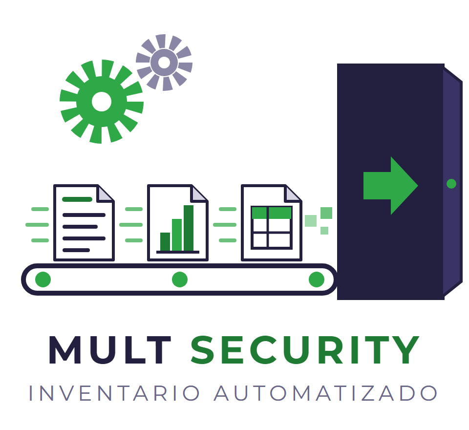
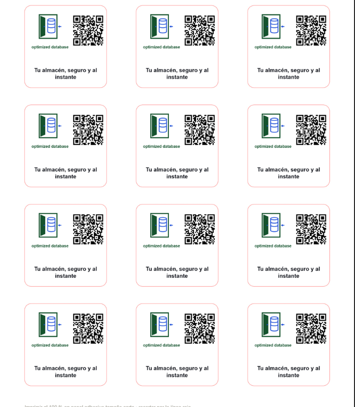

# 10 · Campaña de lanzamiento

En este documento presentamos la identidad y los materiales de lanzamiento de **optimized database**, la solución que proponemos a Multy Security S.A.S. para controlar las entradas y salidas de materiales del almacén por cada área de trabajo. La campaña se dirige a los gerentes de la organización y usa un tono instructivo y confiable: explica qué hace la solución, cómo se usa y por qué se puede confiar en ella.

## 1. Nombre de la solución

El nombre de la solución es **optimized database**. Lo evaluamos con tres criterios:

| Criterio | Evaluación | Resultado |
|---|---|---|
| Corto | Son dos palabras, fáciles de decir y de escribir. | Cumple |
| Recordable | Combina un término conocido (*database*) con uno que indica mejora (*optimized*). Se entiende sin explicación. | Cumple |
| Asociado al beneficio | *Optimized* comunica un inventario más ordenado y rápido, y *database* indica dónde queda registrado cada material. | Cumple |

## 2. Eslóganes

1. Cada material, bajo control.
2. **Tu almacén, seguro y al instante.** ← *Eslogan elegido*
3. Entradas y salidas siempre a la vista.

Elegimos el segundo porque une los dos beneficios principales para el gerente: seguridad en la información e inmediatez en la consulta. Además, tiene 32 caracteres y se lee con facilidad en stickers y piezas pequeñas.

## 3. Paleta de colores y tipografía

Usamos verde oscuro y azul, como pidió el equipo, junto con un neutro claro para fondos.

| Color | HEX | Uso |
|---|---|---|
| Verde oscuro | `#14532D` | Color principal: puerta, nombre y textos. Transmite solidez y confianza. |
| Azul | `#1D4ED8` | Color de acento: base de datos, flecha de entrada y códigos QR. Transmite tecnología. |
| Gris verdoso claro | `#E8F1EC` | Fondos de stickers y piezas impresas. |

**Tipografía:** Montserrat, de Google Fonts (gratuita), en peso Bold para el nombre y Regular para el eslogan y los textos de apoyo.

## 4. Logo

El logo muestra una puerta de seguridad abierta por la que entra una base de datos. Representa una bóveda de datos: la información del almacén ingresa a un espacio protegido y controlado.

## 5. Stickers de lanzamiento

Para el lanzamiento entregaremos a los asistentes una hoja de **12 stickers de 5 × 5 cm**. Cada sticker lleva el logo, el nombre **optimized database**, el eslogan «Tu almacén, seguro y al instante» y un código QR que lleva a **https://multsecuritysas.com/**.

El sticker de 5 × 5 cm permite pegarlo en una libreta, un computador o un casillero. Así el gerente tiene a mano el acceso a la solución. Los colores de los stickers son los de la paleta: fondo claro, textos en verde oscuro y QR en azul.

